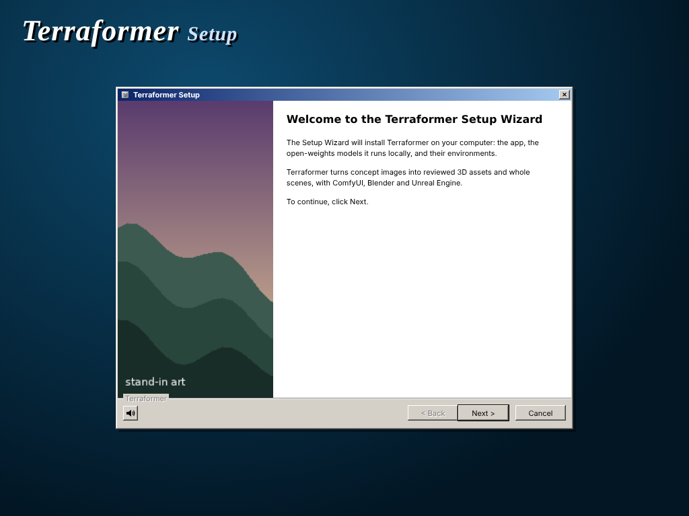
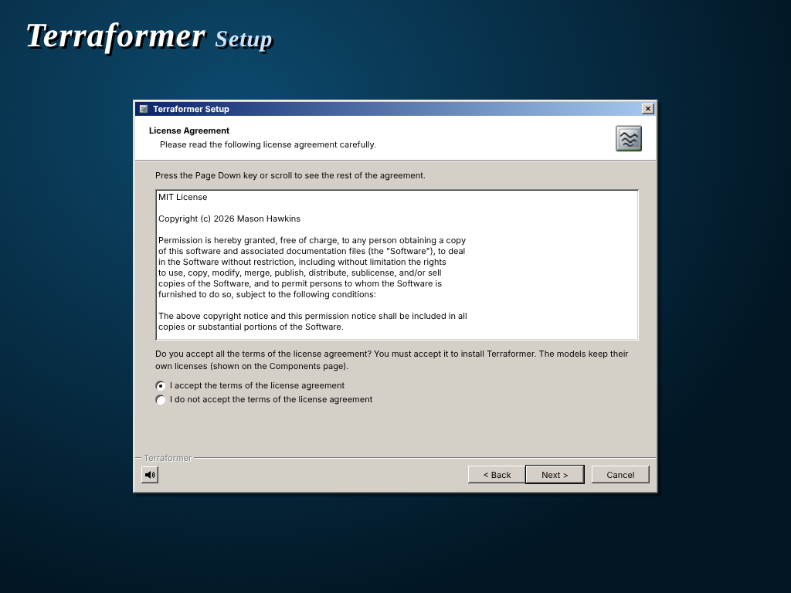
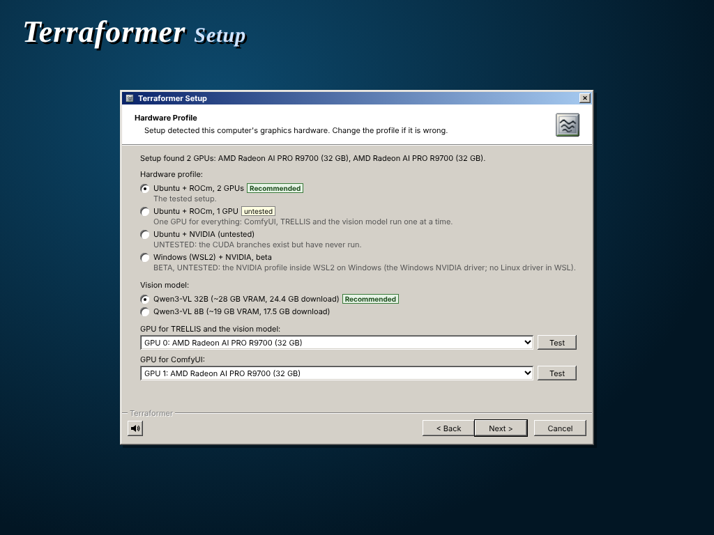
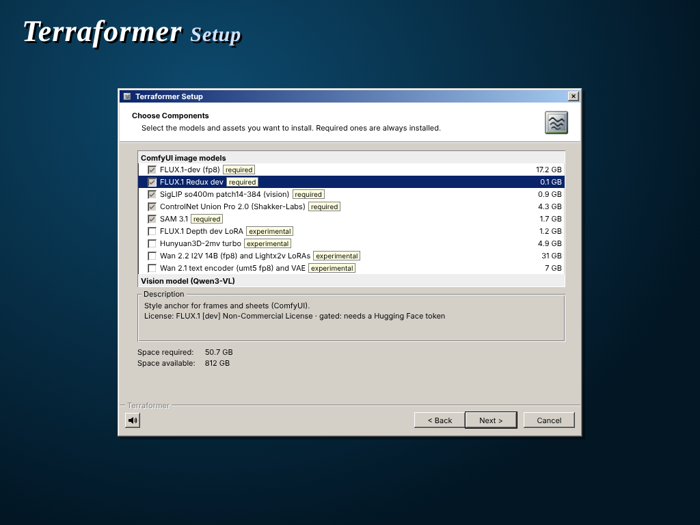
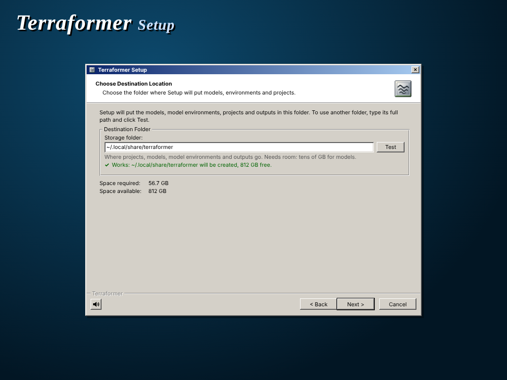
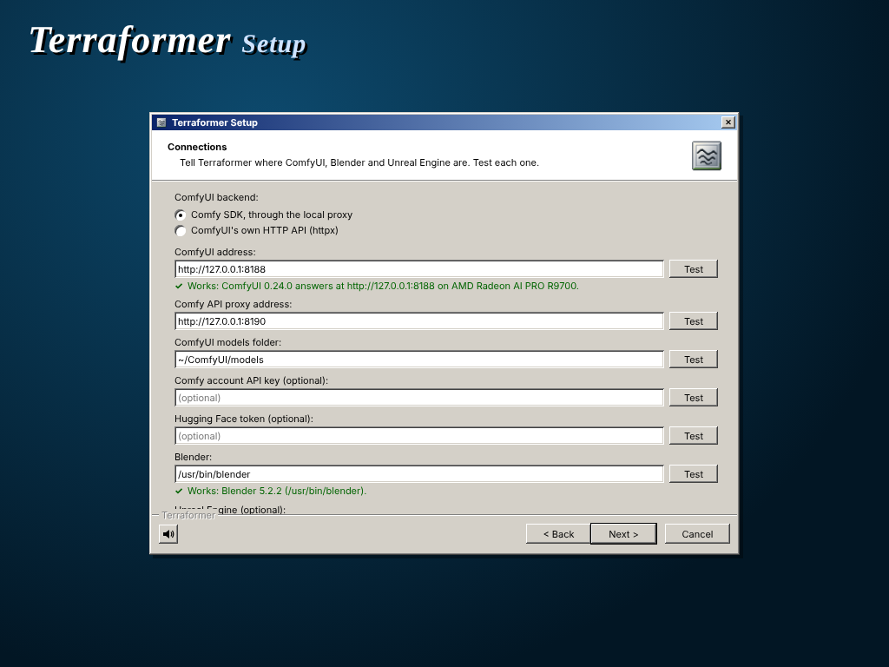
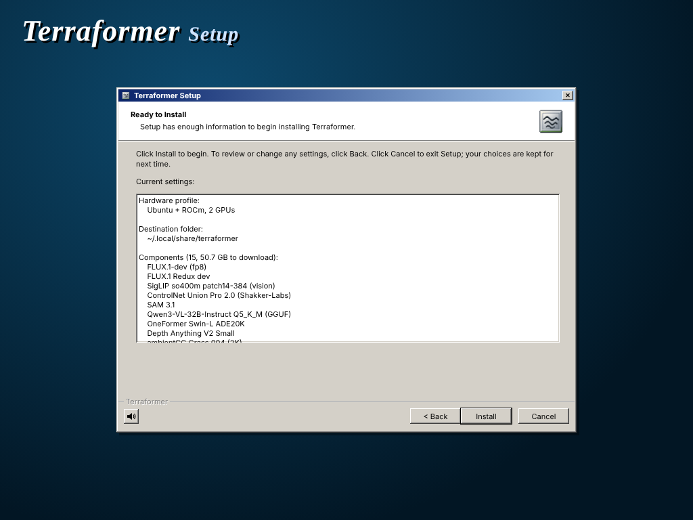
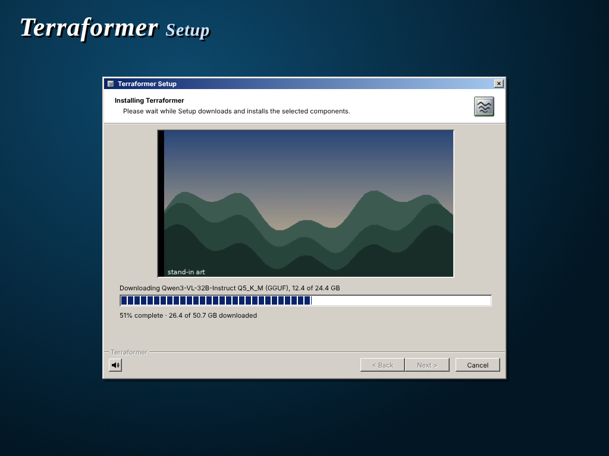
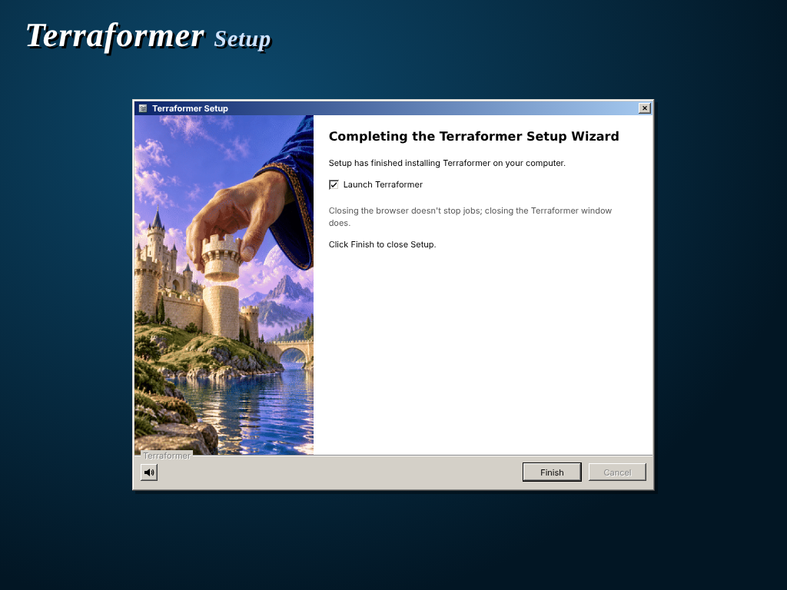

# Terraformer

**A city layout in, a lit Unreal Engine 5.8 scene out: a local 3D environment pipeline on ComfyUI and open-weights models.**


Terraformer is a local-first 3D environment pipeline, built around ComfyUI, that takes a world
layout to a lit Unreal Engine 5.8 scene. You lay out a place (roads, districts, landmarks,
terrain); the pipeline builds a Blender greybox, renders control passes for each camera shot,
paints concept frames from them with FLUX.1-dev, plans which assets the frames call for, builds
those assets, places the whole city in Unreal and lights a scene that matches the approved
frame. Everything runs on your own machine with open-weights models: no partner or API nodes,
no hosted services. It is an entry for the Comfy "Open Source Higgsfield" challenge, category
**Open Weights Only**.

**Demo video:** [watch on YouTube](https://www.youtube.com/watch?v=R8xaOrSxGe4)

[Quick start](#quick-start) · [Requirements](#requirements) · [How ComfyUI is used](#how-comfyui-is-used) ·
[Models and licenses](#models-and-licenses) · [Built during the challenge](#built-during-the-challenge) ·
[Known issues](#known-issues) · [Roadmap](#roadmap)

The repo is [`hawkins-m/terraformer-3d`](https://github.com/hawkins-m/terraformer-3d) (renamed
from `asset-pipeline` on 2026-10-18; the old URL redirects). The command line is `ap`, the Python
package is `asset_pipeline`, and the app (`ap ui`) is called Terraformer.

## Quick start

New machine? `git clone https://github.com/hawkins-m/terraformer-3d.git && cd terraformer-3d && scripts/install.sh`
opens the setup wizard, which installs everything below ([Install](#install) has the details and the manual steps).
With `ap` installed:

```bash
ap setup                           # first run: check and save your settings
ap models download --required      # ~50 GB
ap doctor                          # what is installed, what is missing, how to fix it
ap comfy start                     # ComfyUI and the SDK proxy
ap ui                              # the app, at http://127.0.0.1:8700 (or the desktop launcher)
scripts/demo.sh starter            # neutral starter layout, no Unreal needed
```

Closing the browser doesn't stop jobs; closing the Terraformer window does.

`demo.sh starter [SLUG]` creates a project (default `my-project`), a starter layout, the greybox,
the shot passes and a style text, and generates two concept frames for the `street` shot through
ComfyUI. Frames land under `<storage>/projects/my-project/`. In the app it is Help › Run demo….

The full path on one area of a project, brief to Unreal render:

```bash
scripts/demo.sh area my-project SHOT ENTRY [ENTRY ...]
```

This generates two new frames for the shot, builds the listed buildings procedurally, places
them near the shot's camera, exports GLBs, imports into Unreal headless and renders a look scene.
It needs an existing project with a shot and library entries; see `scripts/demo.sh`,
[USAGE.md](USAGE.md) and [RUNBOOK.md](RUNBOOK.md).

### Greybox-only quick start

A planned city as a greybox in Unreal, with no concept frames, models or ComfyUI:

```bash
ap setup                                                # Blender and Unreal paths
ap new my-project
ap site preset my-project grid                          # layout preset (ap site preset --list)
ap terrain roll my-project --preset coastal-plain --seed 1   # terrain preset (ap terrain presets)
ap site build my-project                                # greybox.blend, about 20 s on the CPU
ap ue build my-project                                  # the greybox in the city level, headless
```

Hardware: CPU only. This path needs Linux, Blender and Unreal Engine 5.8, but no GPU, model
downloads or ComfyUI. A GPU is needed only to open the level in the editor or to render
(`--render`). A generated terrain's Landscape is built with the APLandscape plugin, which works
with Linux engines only for now (see [Known issues](#known-issues)).

## Requirements

- Linux (verified on Ubuntu 26.04). Windows through WSL2 with an NVIDIA GPU is **beta**
  ([below](#windows-wsl2--nvidia-beta)); macOS is not supported.
- Python 3.12 (`python3.12`; the default `python3` may be newer, and every venv here uses 3.12).
- ComfyUI 0.24 or newer (the tested version). The workflows use only core nodes (SAM 3.1
  included).
- Blender 4.2 or newer (verified with 5.2.2; the snap works).
- Unreal Engine 5.8 (free with an Epic account) for the last steps only: import, city build and
  look scenes. The starter demo does not need it.
- GPU memory:
  - Concept frames (Flux fp8, ControlNet, Redux): about 24 GB.
  - Vision LLM: Qwen3-VL-32B Q5_K_M takes about 27 GB on its own GPU; with 24 GB or less, use
    the 8B (`ap config set local.model 8b`).
  - Two GPUs are recommended (ComfyUI on one; the VLM, TRELLIS and Unreal renders on the other).
    One 32 GB GPU works with jobs run one after another.
- Disk: about 50 GB of required models (below), 18 GB more for TRELLIS.2; several hundred GB is
  comfortable with Unreal projects. All of it goes under one storage folder (default
  `~/.local/share/terraformer`).

**Tested on** one machine: Ubuntu 26.04, 2x AMD Radeon AI PRO R9700 (32 GB, gfx1201), ROCm 7.2.4,
ComfyUI 0.24.0, Blender 5.2.2, Unreal Engine 5.8.3.

- Full test suite: 1,119 tests (1,117 offline; 2 more need a live ComfyUI). Offline, all pass except
  `test_wsl.py::test_setup_prefers_a_blender_inside_wsl`, which picks up the host's own snap Blender (a test
  isolation issue).
- Clean install (2026-10-23) from a fresh clone with an empty `HOME`: `ap setup`, the first-run
  Setup screen, `ap doctor`, a new project and its greybox (the model downloads and GPU jobs were
  left out).
- The two ComfyUI backends give identical SAM 3.1 results (`pytest -m comfy`); the SDK backend's
  cancel and error handling were checked against a live ComfyUI.
- Starter path (`scripts/demo.sh starter`) through the SDK backend, on a fresh storage folder:
  greybox and two shots' passes in about 16 s (CPU), two concept frames in 67 s.
- Area path (`scripts/demo.sh area`) on one shot of a larger private test city (about 2.3k
  buildings, 381 exported assets, 29k instances): two frames about 1 min each, 11 procedural
  builds in about 1 min, about 620 per-building instances near the shot in 25 min (CPU), export
  about 3 min, Unreal import about 2 min, look scene 5-11 min (GPU).

**NVIDIA / CUDA is untested.** The code has a CUDA path, but only ROCm has been run.

## How ComfyUI is used

ComfyUI turns each shot's depth, canny and object-ID passes into FLUX.1-dev concept frames (depth and canny
steer the ControlNet, the ID pass writes the prompt and masks the Redux style images) and generates the
reference sheets the 3D models are built from, all through the official Comfy SDK.

ComfyUI does every image generation step (concept frames, the style anchor, the realism pass, reference
sheets) and the SAM 3.1 masks. The pipeline talks to it in one place, the `ComfyClient` interface
(`asset_pipeline/comfy/client.py`, `comfy.client.connect()`), with two backends:

```
browser ──▶ ap ui :8700 ──▶ ComfyClient ──▶ comfy-api-proxy :8190 ──▶ ComfyUI :8188
            (FastAPI,        sdk backend     Comfy API v2              FLUX.1-dev, Redux,
             job lanes)      (httpx: direct to ComfyUI)                ControlNet, SAM 3.1
               ├──▶ Blender, headless: greybox, shot passes, procedural buildings, GLB export
               ├──▶ llama.cpp: Qwen3-VL (plans, briefs) · TRELLIS.2 (optional) · OneFormer, Depth Anything V2
               └──▶ Unreal Engine 5.8, headless: import, city build, look scenes
```

- **`sdk` (default):** the official [Comfy SDK](https://pypi.org/project/comfy-sdk/) (`comfy-sdk` 0.5.0,
  Comfy API v2) through `comfy-api-proxy` in front of your local ComfyUI (`scripts/comfy_api_proxy.sh`;
  `ap comfy start` brings both up).
- **`httpx`:** ComfyUI's own HTTP API, no proxy.

Pick one with `AP_COMFY_BACKEND=sdk|httpx` or `ap config set comfyui.backend sdk`. Both run the same
workflows; the live test (`pytest -m comfy`) checks that SAM 3.1 gives identical results through
both, and that FLUX.1-dev returns real images. The workflows in [`workflows/`](workflows/) are ComfyUI API-format JSON, each with a
`.bindings.json` naming the inputs the pipeline fills in, and use **core nodes only**: no custom
nodes, no API or partner nodes (`comfy_api_nodes`), no hosted services.

| Workflow | Does |
|---|---|
| [`flux_t2i`](workflows/flux_t2i.json), [`flux_t2i_anchor`](workflows/flux_t2i_anchor.json) | FLUX.1-dev text to image; with a Flux Redux style anchor |
| [`flux_control_union`](workflows/flux_control_union.json) | Concept frames held to the greybox's depth (ControlNet Union Pro 2.0) |
| [`flux_img2img`](workflows/flux_img2img.json) | The optional realism pass |
| [`sam3_box`](workflows/sam3_box.json), [`sam3_detect`](workflows/sam3_detect.json) | SAM 3.1 masks from a box or a text prompt (crop checks, silhouettes) |
| [`flux_depth_lora`](workflows/flux_depth_lora.json), [`hunyuan3d_mv`](workflows/hunyuan3d_mv.json), [`wan22_i2v_orbit`](workflows/wan22_i2v_orbit.json) | Experimental, off the default path |

`ap comfy start | status | stop` runs a local ComfyUI for you (or uses the one you already run);
the Setup wizard can install ComfyUI 0.24 into the storage folder.

## Features

- **Layout to greybox.** A layout (`site/layout.json`, or the City planner: districts,
  typologies, height fields, enclosures, terrain ranges) becomes a Blender greybox, built
  headless on the CPU (about 4 s for the starter layout).
- **Exact shot passes.** For each camera shot Blender renders depth, edges, object ids and
  normals (about 3.5 s per shot).
- **Concept frames through ComfyUI.** FLUX.1-dev with ControlNet Union Pro 2.0 (depth) and a Flux
  Redux style anchor paints frames that keep the greybox's layout and scale, plus an optional
  img2img realism pass. All workflows (`workflows/`) use core nodes only.
- **Asset library from the frames.** The id pass says which greybox object is where in an
  approved frame; SAM 3.1, OneFormer and Depth Anything V2 check the crops; FLUX.1-dev makes
  reference sheets.
- **Procedural architecture from a VLM brief.** Qwen3-VL (local, llama.cpp) reads proportions,
  palette and the material of each storey band off a sheet; a facade grammar builds the
  building in Blender with ambientCG CC0 scans. Irregular assets and props can go through
  TRELLIS.2 instead.
- **Reroll with guidance.** The vision model proposes brief edits for a new version, offers only
  the settings a builder uses, says what changed and skips builds identical to an earlier one.
- **Versions and variants.** Every build is a version (pin, restore, compare, prune, "use this
  version"); variant sets, duplicated entries and attached pieces; files stored once by hash.
- **Review gate.** Approve or send back each build, with silhouette and openings checks against
  the locked frames. Only approved builds reach look scenes.
- **The whole city in Unreal, headless.** `ap ue build` exports the library and places every
  build at its real spot (ground-aware, single-building slots and props, baked textures), with a
  check at the end of every build.
- **Look match.** Tints, exposure and the far ridge are read from the approved frame (OneFormer,
  Depth Anything V2) and rendered as an Unreal look scene.
- **No terminal needed.** Every step is a button in the app, with a guide panel, honest step
  states, job lanes with queue positions, VRAM checks and real progress.
- **Setup that checks itself.** `ap setup`, `ap doctor` and `ap models` (pinned, checksummed
  model manifest), with hardware profiles for ROCm (one or two GPUs) and NVIDIA.

## Pipeline overview

**Style → Layout → Greybox → Shots → Frames → Library → Generate 3D Model & Review → Review → Unreal**

Each step is a tab or button in the app (the [RUNBOOK](RUNBOOK.md) describes the clicks) and a
command. **Artist** marks a decision point; everything else runs unattended.

1. **Style.** `ap new`, `ap style text`: the brief and a style text (optional anchor images). **Artist:** writes the brief.
2. **Layout.** `ap site init` (or `--city`): roads, districts, landmarks, terrain. **Artist:** edits the layout.
3. **Greybox.** `ap site build`: terrain and greybox in headless Blender (CPU).
4. **Shots.** `ap shots render`: depth, edge, object-id and normal passes per camera shot (Blender Cycles, CPU).
5. **Frames.** `ap frames generate SHOT -n 4`: FLUX.1-dev, ControlNet Union Pro 2.0 (depth) and Redux through ComfyUI. **Artist:** picks and locks frames (`ap frames lock`).
6. **Library.** `ap library plan`, `ap library check` (SAM 3.1), `ap library sheets` (FLUX.1-dev reference sheets). **Artist:** decides each entry's source and picks the sheet view.
7. **Generate 3D Model & Review.** `ap library brief` (Qwen3-VL reads the sheet), then `ap library build` (procedural Blender, ambientCG materials) or `ap library trellis` (TRELLIS.2); Reroll with guidance. **Artist:** edits the brief and picks versions.
8. **Review.** Library › Asset review, `ap library review apply`, silhouette and openings checks. **Artist:** approves or sends back with a note.
9. **Unreal.** `ap export`, `ap ue build` (the whole city, headless), `ap ue look PROJECT SHOT` (OneFormer and Depth Anything V2 read the frame's look). **Artist:** chooses and tunes the look preset.

## Built during the challenge

The challenge started on 2026-10-08. The last commit before it is tagged
[`pre-challenge`](https://github.com/hawkins-m/terraformer-3d/tree/pre-challenge) (`0cef52e`,
2026-10-07); everything since is in the
[pre-challenge...main compare](https://github.com/hawkins-m/terraformer-3d/compare/pre-challenge...main)
(over 250 commits, about 360 files). Before the challenge the repo had the greybox, shot passes,
FLUX frame generation, the city planner and the first browser UI. Added during it:

- **Unreal city build**: `ap export --assets` and `ap ue build` place the whole city's library
  builds in the Unreal level headless, at their real places; `ap ue stale`, `--only-stale`
  re-imports; look scenes from presets (`ap ue look`) with frame-read tints, exposure and ridge.
- **World dressing**: optional ground textures, rocks, vegetation and water for "Build city in
  Unreal" (`ap ue build --ground --rocks ...`), each tagged Light to Heavy, from free CC0 assets
  (or your Megascans), deterministic per seed; see [World dressing and Megascans](#world-dressing-and-megascans).
- **Library and asset loop**: library planning from locked shots, SAM 3.1 / OneFormer / Depth
  Anything crop checks, procedural facade grammar, material library (ambientCG), TRELLIS.2 route,
  review gate with silhouette and openings checks, areas and batch commands.
- **Reroll guidance**: the vision model proposes brief edits to accept before a build; reroll
  says what changed, offers only the settings a builder uses and skips identical builds.
- **Versions and variants**: asset version bank (pin, restore, compare, prune), variant sets,
  duplicated entries, attached pieces, a shared file store by hash, Storage and Properties
  dialogs.
- **Comfy SDK backend**: every ComfyUI call behind the `ComfyClient` interface, `sdk` (Comfy SDK
  through `comfy-api-proxy`) or `httpx`, with a live parity test; ComfyUI start/stop from the app.
- **Setup and doctor**: one user config outside the repo, `ap setup` and the first-run Setup
  screen, `ap doctor` and the Status box, features switched off with the reason; a clean-install
  test from a fresh `HOME`.
- **Models manager**: `config/models.toml` with pinned revisions, sizes and checksums; `ap models
  list | download | verify` with resume, disk check and gated-repo help.
- **Hardware profiles**: ROCm 2 GPUs, ROCm 1 GPU and NVIDIA (untested), with GPU lanes and memory
  management.
- **The app**: an XP-style classic shell, job dialogs with real progress and Cancel, a UX pass
  (step headers, guide panel, empty states that name the prerequisite), a desktop launcher, and
  a UI for every runbook step.
- **Open-weights scope**: MIT license, paid SDKs moved to an optional extra that refuses to run
  by default, experimental paths marked and kept out of the defaults; the RUNBOOK and this README.

## Layouts and terrain

Added from 2026-10-27, mostly in the Layout tab's roll box and `ap ue build`:

- **City layout presets**: 20 overall city shapes (classic, grid, manhattan, walled-castle, star-fortress,
  island-city, hill-town...) in the Layout picker; `ap site preset`.
- **Random preset and Keep current outline**: a roll can pick a preset per seed, or keep the current outline
  and districts while the rest rerolls.
- **Terrain presets**: 8 generated terrains (flat plain, coastal plain, river valley, hill city, mountain bowl,
  plateau, island, canyon) with their own seed; rivers, canals and docks are lowered into the ground; the plan
  avoids water and steep ground; `ap terrain roll --preset`.
- **Describe the terrain**: text to a preset plus tweaks with the local vision model, else keywords;
  `ap terrain roll --describe`.
- **Unreal Landscape**: a generated terrain becomes `AP_Landscape` with the auto material, made headless by the
  repo's APLandscape editor plugin; heightmap projects keep their own Landscape.
- **Run kit role**: a module repeated along a thin slot, following its curve (a stoa, a colonnade).
- **Use unplaced assets**: built assets the plan has no slot for take a share of fitting places at build time
  (`ap ue build --use-unplaced`).
- **Stretch cap**: no placed model stretches past 1.4:1; it becomes a run of copies, a same-family swap, or a
  capped fit, listed in the build report.
- **Stone paving**: CC0 slabs, cobbles and flagstones on streets, lanes and plazas, world-aligned with macro
  variation (part of Ground textures).
- **Library commands**: `ap library status` (where each asset waits), `repair-plan` (decided assets back in
  the plan), `stand-in` (an excluded entry's buildings take another entry's model).

## Install

**Before you install**

- [ ] Admin rights on the computer (to install the GPU driver, Blender and, on Windows, WSL2).
- [ ] Windows (beta, untested): virtualization switched on in the BIOS/UEFI, which WSL2 needs.
- [ ] Free disk space: the wizard's storage step shows what the chosen components need (about 50 GB
      for the required models, 18 GB more for TRELLIS.2).
- [ ] A Hugging Face account, signed in, with the
      [FLUX.1-dev license](https://huggingface.co/black-forest-labs/FLUX.1-dev) accepted, and a
      [read token](https://huggingface.co/settings/tokens).
- [ ] Time: the model downloads are long (tens of GB); they resume if interrupted.

The wizard's **What you still need** page lists what this computer is still missing, each with a
link to its official page, and **Check again**. ComfyUI shows as "Setup installs it" (the wizard installs a local
one by default, see below), not as something to download. It shows before Installing, so you can point to
ComfyUI models you already have before anything downloads, and again after it as the final check;
the end of `ap doctor` shows the same list.

### Setup wizard

The quickest install is the setup wizard, a classic installer in your browser:

```bash
git clone https://github.com/hawkins-m/terraformer-3d.git && cd terraformer-3d
scripts/install.sh                 # Windows: double-click windows\install.bat (below)
```

`scripts/install.sh` checks only what the wizard's own small server needs (Python 3.12 with venv,
git, curl), starts it and opens <http://localhost:8705/>. The wizard does the rest: hardware
profile, components (every model in [config/models.toml](config/models.toml) and the CC0 dressing
assets, with sizes and free disk space), storage folder, ComfyUI / Blender / Unreal connections
(each with a Test button), then installs the app, the `ap` command, the models (`ap models download`
with resume and checksums) and the model runtimes ([installer/runtimes.toml](installer/runtimes.toml)).
Keep the terminal open while it installs; if it closes, run the same command again (or `ap setup`)
and it resumes: finished steps are skipped and partial downloads continue. On an installed system
`ap setup` opens the same wizard to add components or change settings (`ap setup --terminal`
asks in the terminal instead). The pages read the hardware profiles, the manifest and the setup
items, so a new model or setting appears without changing the wizard. The steps below do the same
by hand.

- **Recommended** marks the best choice for the detected hardware, preselected: the profile, and the
  vision model that fits the TRELLIS/vision GPU (Qwen3-VL 8B under 28 GB).
- **ComfyUI by default**: a running ComfyUI (or a ComfyUI folder) is found and filled in. When there
  is none, Components offers **Install ComfyUI (local)**, checked: Setup installs ComfyUI 0.24.0
  with its own venv in `<storage>/ComfyUI` (`scripts/install_comfyui.sh`), downloads the models
  into it and starts it at `http://127.0.0.1:8188` (this computer; nothing is sent online).
- **Keys later**: the optional keys (Hugging Face token, Comfy account) can be skipped and added in
  the app under **File › Settings…** (or the gear in the toolbar) › Keys & connections, which has every
  setting of the wizard's Connections page with a Test each. The Status box says
  "Setup: missing key — Settings" when a feature needs a key that isn't set.
- **App window**: the wizard, the Linux launcher (`ap launcher install`, which Setup runs: a menu
  entry with the Terraformer icon), the Windows Start menu shortcut and "Launch Terraformer" open
  in their own window (Chrome, Chromium or Edge `--app`: no tabs or address bar), else in the default
  browser. `ap config set ui.app_browser NAME` picks another browser with an app mode.

| | | |
|---|---|---|
|  |  |  |
| 1 Welcome | 2 License | 3 Hardware profile |
|  |  |  |
| 4 Components | 5 Destination | 6 Connections |
|  |  |  |
| 7 Ready to install | 8 Installing | 9 Finish |

The screenshots show a synthetic machine (`scripts/installer_screenshots.py` renders them headless).

### Hardware profiles

`ap setup` detects the GPU vendor, count and VRAM (`rocm-smi` / `nvidia-smi`) and preselects a
profile; you can override it (`ap config set hardware.profile ...`). The profile sets the PyTorch
build the model environments install, which GPU each job lane uses, and the scheduling.

| Profile | PyTorch | GPU lanes | Status |
|---|---|---|---|
| Ubuntu + ROCm, 2 GPUs (`rocm-2gpu`) | ROCm 7.2 | TRELLIS and the vision model on GPU 0, ComfyUI on GPU 1 | the tested setup |
| Ubuntu + ROCm, 1 GPU (`rocm-1gpu`) | ROCm 7.2 | everything on GPU 0, one job at a time | scheduling tested by simulation only |
| Ubuntu + NVIDIA (`nvidia`) | CUDA 12.8 | as above, by GPU count | **untested**: the CUDA paths have never run |
| Windows (WSL2) + NVIDIA, beta (`wsl-nvidia`) | CUDA 12.8 | as above, by GPU count | **beta, untested**: the `nvidia` profile inside WSL2 |

What differs per profile (the steps below are otherwise the same):

- **ROCm, 2 GPUs**: the steps as written.
- **ROCm, 1 GPU**: in `ap setup` (step 3) pick `Ubuntu + ROCm, 1 GPU` (both GPU roles on GPU 0).
  With less than ~28 GB on the card, take the 8B vision model before downloading:
  `ap config set local.model 8b` (the required download drops to 43.7 GB). ComfyUI, TRELLIS and
  the vision model share one slot and run in submit order; ComfyUI is asked to unload before
  TRELLIS or the vision model starts, and the vision model is unloaded before a ComfyUI job.
- **NVIDIA (untested)**: pick `Ubuntu + NVIDIA (untested)` in `ap setup` before installing the
  model environments, so they get CUDA wheels (`cu128`; or `export AP_TORCH=cu128` for the install
  scripts). Skip `scripts/setup_rocm_toolchain.sh`; TRELLIS.2 needs the CUDA toolkit for its
  extensions. The llama.cpp build is the Vulkan one, which should run on NVIDIA too. Expect to
  debug.

Each feature has a VRAM floor from the manifest (ComfyUI image models ~24 GB, the 32B vision model
~28 GB, the 8B ~19 GB, TRELLIS.2 ~16 GB); a feature the card can't run is switched off in the app
with the reason. Memory held by programs the app didn't start is never touched.

### Steps

Your settings live in one user config outside the repo, `~/.config/terraformer/config.toml` (API
keys in `secrets.toml` beside it, mode 0600); environment variables win over it. To put the
storage folder on a big drive, set it before downloading:
`ap config set paths.ap_root /path/to/storage/terraformer` (or `export AP_ROOT=...`).

1. **The pipeline.**
   ```bash
   git clone https://github.com/hawkins-m/terraformer-3d.git && cd terraformer-3d
   python3.12 -m venv .venv && source .venv/bin/activate
   pip install -e '.[dev]'
   mkdir -p ~/.local/bin && ln -sf "$PWD/scripts/ap" ~/.local/bin/ap   # `ap` in any shell, venv or not
   ```
   The `[paid]` extra (Gemini and Claude SDKs) is not needed; the paid backends refuse to run
   unless `AP_ALLOW_PAID_APIS=1` is set.

2. **ComfyUI.** The setup wizard installs a local ComfyUI for you when it finds none. To use your own
   instead (its own venv; this repo only talks to it over HTTP and never modifies it), tell the pipeline where its models folder is and how to launch it
   (`{port}` is filled in):
   ```bash
   ap config set comfyui.models_dir ~/ComfyUI/models
   ap config set comfyui.service.launch "~/ComfyUI/venv/bin/python main.py --listen 127.0.0.1 --port {port}"
   ap config set comfyui.service.cwd ~/ComfyUI
   ```
   `ap setup` (step 3) can find these from a running ComfyUI. `ap comfy start|stop|restart|status`
   (or **Start ComfyUI** in the app) only launches and stops it.

   **Run ComfyUI through the Comfy SDK backend** (the default): the official Comfy SDK
   (comfy-sdk 0.5.0, Comfy API v2) through `comfy-api-proxy` 0.1.6, next to your local ComfyUI.
   ```bash
   scripts/comfy_api_proxy.sh install      # its own venv, port 8190
   ap config set comfyui.backend sdk       # the repo default; "httpx" uses ComfyUI's own HTTP API, no proxy
   ap comfy start                          # starts ComfyUI if needed, then the proxy
   ```
   `AP_COMFY_BACKEND=sdk|httpx` overrides the config for one shell. ComfyUI 0.24 and older lack
   the proxy's cancel route, so Stop falls back to `/queue` delete plus `/interrupt`. The proxy
   does not return 3D outputs; only the experimental Hunyuan path needs `httpx`.

3. **Setup.** `ap setup` opens the [setup wizard](#setup-wizard); `ap setup --terminal` asks in the
   terminal instead for the storage folder, the hardware profile, the ComfyUI backend
   and address, Blender, Unreal (optional) and the GPU for each role; what it finds is pre-filled
   and each answer is tested. `ap setup --check` only tests, `ap setup --yes` takes what it
   found. The app opens the same Setup screen on first run (later: Tools › Setup…).
   `ap config show` prints what is in effect; `ap config set SECTION.KEY VALUE` changes one value.

4. **Models (about 50 GB).** Everything is listed in [config/models.toml](config/models.toml)
   with pinned revisions, sizes and checksums:
   ```bash
   ap models list                                # every model, installed or missing, and its size
   ap models download --required --dry-run       # the plan and the disk check
   ap models download --required                 # 50.6 GB: ComfyUI 24.3, vision model 24.4 (32B), segmentation/depth 1.9
   ap models verify
   ```
   With the 8B vision model (`ap config set local.model 8b` first) it is 43.7 GB. Files already
   there are skipped, partial files resume, checksums are verified. FLUX.1 Redux dev is gated:
   the download stops and says what to do (accept the license on the model page,
   then a Hugging Face read token via `hf auth login` or `ap setup`). `--json` prints progress
   events for scripts.

5. **Model runtimes.**
   ```bash
   scripts/install_llamacpp_vlm.sh llamacpp 32b   # llama.cpp Vulkan build for Qwen3-VL (or 8b)
   scripts/install_segdepth.sh                    # OneFormer and Depth Anything V2 Small
   ```
   The vision server starts on demand and unloads when idle (`ap vlm`).

6. **TRELLIS.2** (optional, for irregular assets; not on the demo path). On ROCm/gfx1201:
   ```bash
   scripts/setup_rocm_toolchain.sh      # one time, no sudo (skip on NVIDIA)
   scripts/install_trellis2.sh venv deps trellis nvdiffrast cumesh flexgemm ovoxel nvdiffrec weights verify
   ```
   The `weights` stage is `ap models download --feature trellis --all` (18.0 GB). DINOv3 is a
   gated Meta repo; the download explains and names an ungated mirror
   (`ap config set models.dinov3_repo ...`).

7. **Doctor.** `ap doctor` checks storage, GPUs, ComfyUI and the proxy, that ComfyUI sees each
   model file the workflows load, Blender, Unreal, the vision model, segmentation and TRELLIS,
   and prints what is missing with the command that fixes it. The app shows the same in its
   Status box (Tools › Doctor…) and switches off only what a missing piece needs.

8. **Desktop launcher** (optional): `ap launcher install` adds **Terraformer** to the Linux
   applications menu, so day-to-day work needs no terminal.

### Windows (WSL2) + NVIDIA, beta

The pipeline runs inside WSL2 (Ubuntu) as the normal Linux install with the `wsl-nvidia` profile;
a Windows launcher starts it and opens your browser. **Beta: none of this has run on a Windows
machine yet** (the tests mock `wslpath` and the Windows programs).

Needs Windows 11, or Windows 10 21H2 (build 19044) or newer, and a current NVIDIA driver for
Windows (Game Ready or Studio). Do not install a Linux NVIDIA driver inside Ubuntu: WSL uses the
Windows one.

#### Installing on Windows

1. Download the ZIP (Code › Download ZIP on the repo page).
2. Right-click the ZIP › **Extract All**. Don't run anything from inside the zip.
3. Double-click `windows\install.bat`. If Windows warns, click **More info › Run anyway**.
4. Allow the WSL install when it asks, then restart Windows.
5. Double-click `windows\install.bat` again.
6. Ubuntu opens and asks you to create a Linux username and password. At the Linux prompt (ending
   in `$`), type `exit` and press Enter to return to the installer.
7. The setup wizard opens in your browser; follow it.
8. Later, start Terraformer from the **Terraformer** shortcut. Keep its console window open while
   you use the app: closing it stops Terraformer.

The same steps in detail:

1. Download the repo (Code › Download ZIP, or `git clone`) anywhere on Windows. **Extract the zip
   first**; don't run `install.bat` from inside the zip, it needs the files beside it. Then double-click
   `windows\install.bat` (or run `windows\install.bat -NoDesktopShortcut`, `-Distro NAME`, `-Yes`).
   It
   - checks the Windows version and WSL; if WSL is missing it asks, installs it (admin prompt)
     and asks you to restart Windows and run `install.bat` again;
   - installs `Ubuntu-24.04` in WSL if it is missing (it asks first; Ubuntu then asks for a Linux
     user name and password), and converts it to WSL 2 if needed;
   - checks that `nvidia-smi` works inside WSL;
   - clones the repo inside WSL at `~/terraformer-3d`;
   - writes the launcher `%LOCALAPPDATA%\Terraformer\Terraformer.bat` and a **Terraformer**
     shortcut in the Start Menu and on the desktop;
   - starts the [setup wizard](#setup-wizard) inside WSL (`scripts/install.sh --profile wsl-nvidia`)
     and opens it in your Windows browser; it installs the app, models and runtimes.
2. Inside WSL (Start Menu › Ubuntu), install ComfyUI if you haven't (README step 2), then run
   `ap doctor`. The by-hand [Steps](#steps) work too; skip `scripts/setup_rocm_toolchain.sh` and
   `ap launcher install`.
3. Start **Terraformer** from the Start Menu. It runs `ap ui` inside WSL and opens your default
   browser at <http://localhost:8700/>. Closing its window (or Ctrl+C in it) stops `ap ui`; an
   `ap ui` that was already running is left alone.

In Setup (`ap setup` or the app's Setup screen):

- **Storage** stays on the WSL filesystem (the default `~/.local/share/terraformer`). The Windows
  drives (`C:\` is `/mnt/c` in WSL) are slow from WSL and break the hard links the file store and
  backups use; Setup and `ap doctor` warn when storage is there.
- **Blender**: a Blender installed inside WSL (e.g. from blender.org's Linux build) is preferred
  and found first. A Windows Blender works too: paste its Windows path
  (`C:\Program Files\Blender Foundation\Blender 4.2\blender.exe`).
- **Unreal** stays on Windows: paste
  `C:\Program Files\Epic Games\UE_5.8\Engine\Binaries\Win64\UnrealEditor-Cmd.exe` (or the
  `UE_5.8` folder). Put the Unreal projects folder on a Windows drive (e.g.
  `C:\Users\you\Documents\Unreal Projects`); Setup warns otherwise.

Windows paths are stored as WSL sees them (`wslpath -u`). A Windows `.exe` runs through WSL
interop: the pipeline gives it Windows paths (`wslpath -w`, including the paths inside its JSON
job files and `AP_UE_ARGS` through `WSLENV`) and turns the Windows paths in the JSON files it
writes back into Linux paths. `ap doctor` shows the WSL check with the beta label and what is
untested.

Known limits (beta):

- Untested end to end on Windows: the CUDA wheels, TRELLIS.2's extensions and the llama.cpp
  Vulkan build on WSL's NVIDIA driver; Windows Blender and Unreal through interop.
- Stop on a job running a Windows program ends the Linux side; the Windows process may keep
  running (end it in Task Manager).
- The "Unreal Editor has this project open" check can't see an editor window on Windows: close
  it yourself before an import or backup.
- Only paths in arguments, in the JSON files named on the command line and in `AP_UE_ARGS` are
  translated; Unreal reading projects on `\\wsl.localhost` is slow, hence the Windows-drive
  projects folder.
- WSL 2 must reach `localhost` (the default `localhostForwarding`, or mirrored networking) for the
  browser to open the app. GPU memory in WSL is shared with Windows: close GPU-heavy Windows apps.

### ROCm notes

Details in [docs/notes/machine-and-gpu.md](docs/notes/machine-and-gpu.md).

- Tall GEMMs silently return corrupt results on gfx1201; `scripts/gfx1201_guard.py` chunks
  `F.linear` in any torch process that installs it.
- `hipMemcpy2D` device-to-device copies only the first 2^20 rows and still reports success; the
  CuMesh build for TRELLIS.2 is patched to chunk them.
- Never set `PYTORCH_CUDA_ALLOC_CONF=expandable_segments:True` on ROCm: silent NaNs. (The NVIDIA
  profile sets it for GPU jobs.)
- Build HIP extensions with `scripts/setup_rocm_toolchain.sh` once, then
  `source scripts/rocm_build_env.sh` in the shell that builds. No flash-attn; sdpa is used.

## License

The code is **MIT**, see [LICENSE](LICENSE). The models, assets and tools carry their own licenses, collected in
[THIRD_PARTY_LICENSES.md](THIRD_PARTY_LICENSES.md). No model weights or assets are in this repository: they
download on setup from their original sources.

### Models and licenses

All open weights, all run locally. The full list with sources, pinned revisions, sizes and
checksums is [config/models.toml](config/models.toml) (`ap models list --all`). **Commercial use requires a commercial license from each model's owner wherever that model's license calls for one; check every row below before using any output commercially.** Several are non-commercial, so the pipeline as configured
is for non-commercial use unless you swap those models.

| Model | Used for | Needed | License |
|---|---|---|---|
| FLUX.1-dev (fp8) | Concept frames, reference sheets | required | FLUX.1 [dev] Non-Commercial License |
| FLUX.1 Redux dev (gated) | Style anchor | required | FLUX.1 [dev] Non-Commercial License |
| SigLIP so400m patch14-384 (vision) | Redux image encoder | required | Apache-2.0 |
| ControlNet Union Pro 2.0 (Shakker-Labs) | Depth control of frames | required | FLUX.1-dev non-commercial (derivative) |
| SAM 3.1 (gated) | Text- and box-prompted masks | required | Meta SAM License |
| OneFormer Swin-L ADE20K | Frame classes (segmentation) | required | MIT |
| Depth Anything V2 Small | Frame depth | required | Apache-2.0 (Base, Large, Giant are CC-BY-NC-4.0 and not used) |
| Qwen3-VL 32B or 8B Instruct (GGUF, llama.cpp) | Plans, briefs, material reading | one of them | Apache-2.0 |
| TRELLIS.2-4B | Irregular assets | optional | MIT |
| TRELLIS image large | TRELLIS.2 conditioning | optional | MIT |
| BiRefNet | Background removal (TRELLIS.2) | optional | MIT |
| DINOv3 ViT-L/16 (gated) | Image features (TRELLIS.2) | optional | Meta DINOv3 License |
| ambientCG 2K sets | Building materials | fetched on use | CC0 |
| ambientCG Grass004, Ground106, Rock030, Ground093C (2K) | World dressing: ground textures | optional | CC0 |
| ambientCG PavingStones054, PavingStones119, PavingStones128 (2K) | World dressing: street and plaza paving | optional | CC0 |
| Poly Haven rock_07, boulder_01, shrub_02 (1k glTF) | World dressing: rocks, shrubs | optional | CC0 |

Code dependencies with notable licenses: nvdiffrast and nvdiffrec (NVIDIA Source Code License,
non-commercial), used by TRELLIS.2.

### Tools beyond ComfyUI

- **Blender 5.x** (GPL): greybox, data passes, procedural buildings, GLB export.
- **Unreal Engine 5.8** (free with an Epic account, Epic EULA): headless import and offscreen
  renders. Optional for the early stages.
- **TRELLIS.2**: irregular assets (optional).
- **llama.cpp**: serves the Qwen3-VL GGUFs.

### Experimental, not part of the entry

Wan 2.2 hero orbits, Hunyuan3D-2mv (Tencent Hunyuan Community License, not licensed in the EU,
UK or South Korea) and a Mask2Former A/B exist as prototypes and are not on any demo path.
Paid backends (Gemini, Claude) exist but are off by default and refuse to run without
`AP_ALLOW_PAID_APIS=1`; the entry does not use them. The SDK can also target Comfy Cloud; that
is untested and not used.

## World dressing and Megascans

"Build city in Unreal" (Unreal tab) and `ap ue build` can dress the world: **Ground textures**
(Light: grass, dirt patches, rock on slopes, sand at the shore; stone paving on streets and plazas:
slabs, cobbles, flagstones), **Rocks** (Light–Medium, density
slider), **Vegetation** (Medium–Heavy: tree meshes for the placeholder trees, olives in open green,
shrubs and grass in green zones; density slider) and **Water** (Simple sea, Light; or the Water
plugin's Ocean, Heavy and experimental: in UE 5.8 the plugin crashes the headless editor when it
places a water body, so the build enables the plugin and uses Simple sea, and you can add a Water
Body Ocean by hand in the editor). Each option is cheap by default and remembered per project; unticking one removes what
it placed on the next build. The build report lists instances per role, the options that ran and
where each role came from:

- **CC0 (default, no account):** ambientCG ground sets and Poly Haven rocks and shrub, fetched on first
  use through the model manifest (`ap models download --feature dressing --all` to get them ahead).
- **Fallback:** stylised Blender meshes where no suitable CC0 asset exists (umbrella pine, cypress,
  olive, grass tufts).
- **Megascans:** your own, where you map them. Megascans are licensed for use in Unreal only, so
  Terraformer never downloads them and nothing from Fab goes into this repo.

```
ap ue build my-project --ground --rocks --dress-vegetation --water simple
ap ue build my-project --rock-density 2 --no-ground       # flags left out keep the last-used choice
ap ue build my-project --no-dressing                      # everything off (removes what was placed)
ap ue scan-assets my-project --apply                      # Megascans: propose and save the mapping
```

**Getting Megascans via Fab (Windows).** Open your project in Unreal, then Window › Fab (or in the
Epic Games Launcher, the Fab tab), pick a Megascans pack (rocks, trees, shrubs, grass, ground surfaces)
and **Add to Project**. Then in Terraformer tick **Use Megascans assets** and click **Find my assets**:
it scans `/Game/Fab`, `/Game/Megascans`, `/Game/Quixel` and any folder you add, proposes a role for
each asset from its name, and lets you change the mapping. A Windows Unreal project under the WSL
setup is scanned through its WSL path. Builds with Megascans ticked scan again and fill roles whose
asset is new or gone; your own choices stay.

**Moving Megascans to another machine** (for example a Linux Unreal, which ships without the Fab
plugin): on the source machine, with the same engine version, right-click the imported folder in the
Content Browser › **Asset Actions › Migrate**, and pick the target project's `Content` folder (or copy
that folder over by USB into the target's `Content`, keeping its path). Then click **Find my assets**.

## Design note

Terraformer's interface (screenshot at the top) is deliberately styled after Windows XP/Me-era desktop software: menu
bar, toolbar, group boxes, tabbed panels, status bar and Tahoma / MS Sans Serif-style type. Its
muted grey palette avoids near-white glare during long sessions. Each pipeline stage has its own
small animated job icon (frame generation, greybox building, 3D conversion, Unreal export and
more), so long GPU jobs stay readable at a glance. The intent is a calm, dense, tool-like
workspace for artists rather than a web-app look.

## Known issues

- Clean up can produce wrong scale or broken texture bakes; it is optional, check results before using them.
- The generated-terrain Landscape export (APLandscape plugin) builds for Linux engines only for now.
- The Water plugin's ocean can't run in the headless build: the build uses the Simple sea instead; place an
  ocean by hand in the editor.
- Describe the terrain falls back to keyword matching when the local vision model isn't running.
- The utopia layout preset keeps its old overlaps (the generator as it was before presets).
- Editing the greybox in Blender and clicking Re-read .blend only rewrites `site/greybox.json`. Approvals, Active versions and builds are kept, and nothing rebuilds or re-plans. On the next `ap ue build`, kit and landmark builds follow their slot's new pose. Typed buildings stay where the city plan (`layout.json`) puts them, and stay greybox if their slot moved away from them. Hand moves in Unreal are kept: a slot only moves back where a committed `greybox.blend` put it, so commit the project's greybox before you edit it.

## Roadmap

- Restore points / undo before risky actions
- Show the impact of upstream changes on models and placements
- Adjustable cleanup settings, collision and Nanite readiness
- Small sample project with supplied intermediate results
- Final comparison workspace: approved concept beside the Unreal render
- Brief & build view thumbnails with scores
- More procedural builder parts (multi-box masses, set-back top storey, framed openings)
- Native app packaging
- Blender hand-finish workflow
- Optional API vision backends (OpenAI-compatible: ChatGPT, Grok, other servers)
- Thumbnails for the city layout and terrain presets
- Simpler layout controls in the Layout tab
- A shorter name for the Generate 3D Model & Review tab
- Ready for Unreal: refresh the unplaced-assets preview when it goes stale

## Docs

- [USAGE.md](USAGE.md): running the tools and the UI.
- [RUNBOOK.md](RUNBOOK.md): the daily asset loop for one area, common failures.
- [PLAN.md](PLAN.md): design, stages and milestones.
- [CLAUDE.md](CLAUDE.md): working rules; [docs/notes/](docs/notes/): machine facts, measured findings and pitfalls.
- [THIRD_PARTY_LICENSES.md](THIRD_PARTY_LICENSES.md): licenses of the models, assets and tools.
- [docs/release-notes-v0.1.0.md](docs/release-notes-v0.1.0.md): what is in the first release.

## Credits

- TRELLIS.2 ROCm recipe: [bioritmovideo/trellis2-rocm-gfx1201](https://github.com/bioritmovideo/trellis2-rocm-gfx1201).
- nvdiffrast ROCm port: Painter3000 ([amd-nvdiffrast-rocm72-gfx1201](https://github.com/Painter3000/amd-nvdiffrast-rocm72-gfx1201)).
- Thanks to [egore/comfyui-trellis2-gguf-rocm](https://github.com/egore/comfyui-trellis2-gguf-rocm),
  whose notes first got CuMesh building on ROCm. The CuMesh fixes used here are our own.
- [ambientCG](https://ambientcg.com) for the CC0 materials, ground and paving textures, and
  [Poly Haven](https://polyhaven.com) for the CC0 rocks and shrub. Both are fetched from their sites on
  first use, never bundled.
- Megascans (Fab) assets are **not** redistributed: Terraformer never downloads them, and nothing from Fab is
  in this repo. If you own them, you map your own copies into your Unreal project.
- [Comfy](https://www.comfy.org) for ComfyUI and the Comfy SDK, and the authors of every model above.
